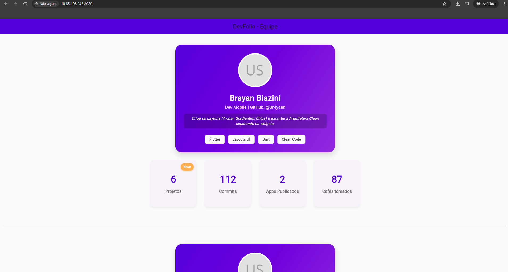
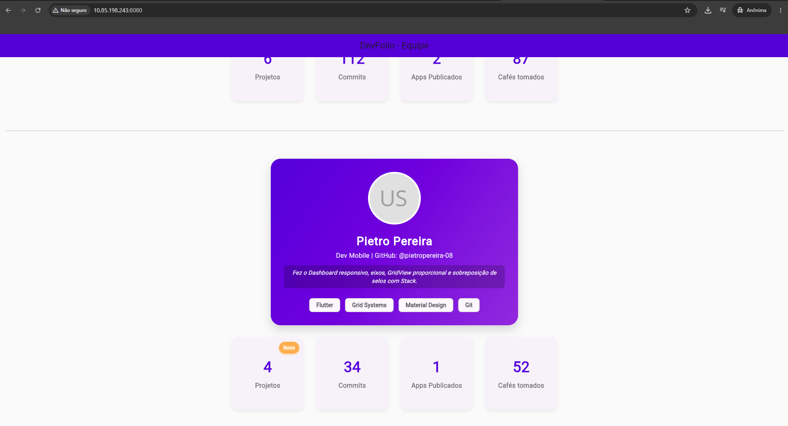

# DevFolio App 🚀

Um projeto de portefólio construído em Flutter, focado em **Componentização**, **Clean Architecture** e **Responsividade**. Desenvolvido em dupla para cumprir rigorosamente os critérios técnicos de avaliação.

## 👥 Equipa e Contribuições

- **Brayan Biazini:** Estruturação da Clean Architecture, componentização (`lib/widgets/`), layouts dinâmicos, gradientes e estilização avançada do crachá.
- **Pietro Pereira:** Implementação do Dashboard responsivo, eixos proporcionais, `GridView` adaptável e sobreposição de selos de destaque com `Stack` e `Positioned`.

## 🛠️ Tecnologias e Estruturas Utilizadas

- **Flutter & Dart**
- **GridView.count:** Implementado para a grelha responsiva dos blocos de estatísticas.
- **Stack & Positioned:** Utilizados para a sobreposição do selo "Novo" nos cartões do dashboard.
- **LinearGradient & CircleAvatar:** Aplicados para a estilização visual premium do perfil.
- **LayoutBuilder & ConstrainedBox:** Para garantir uma adaptação perfeita do layout no navegador web.

## 📸 Demonstração do Projeto
*(A imagem abaixo comprova a aplicação a correr no servidor local do Senai na porta 8080)*




## 🚀 Como Executar

Para testar o projeto no ambiente web, clone o repositório e execute o seguinte comando:
```bash
flutter run -d web-server --web-port 8080
